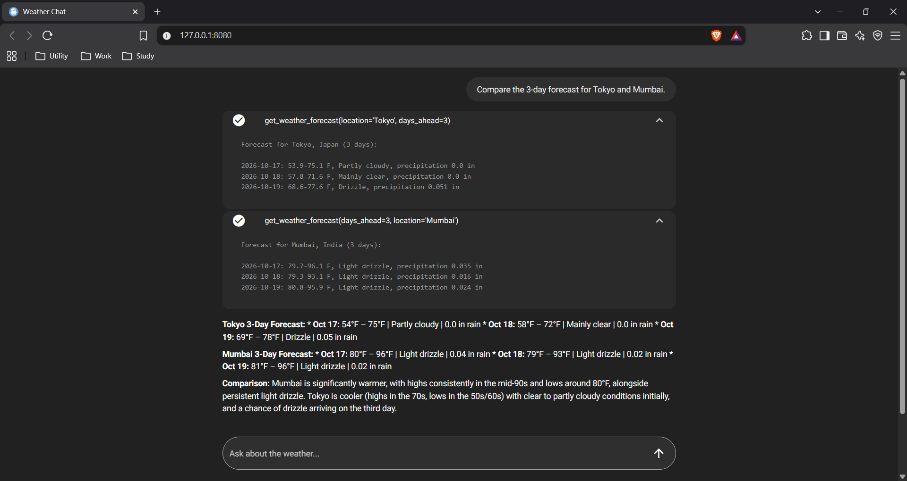

# Weather Chat



Weather Chat is a NiceGUI web app where a Pydantic AI assistant answers weather questions using tools from a local FastMCP server.

## What the project does

The project is made up of two Python processes:

- **Chat app (`app.py`)** — serves the browser UI with NiceGUI, creates a Pydantic AI agent, and connects that agent to the weather server through FastMCP's stdio client transport. It presents suggested questions, keeps message history for the chat, and streams tool-call and tool-result steps into the conversation.
- **Weather MCP server (`server.py`)** — registers three tools (`get_weather_forecast`, `get_historical_weather`, and `calculate_rain_probability`), a `weather://about` resource, and a `plan_outdoor_event` prompt. The tools use Open-Meteo for geocoding, forecast, and historical weather data. This is from Prefect's official FastMCP tutorial example!

When the app starts, it launches `server.py` as a subprocess using the same Python interpreter. The assistant is instructed to use the weather tools rather than guess weather data, and receives the current date as context. On shutdown, the app closes the agent and its MCP connection.

Forecasts and rain estimates cover up to 16 days ahead. Historical weather covers roughly the past 80 years. Temperatures are in Fahrenheit; precipitation is in inches.

## Execution flow

```text
Browser
  | question
  v
NiceGUI chat (app.py)
  | Pydantic AI agent
  | MCP client over stdio
  v
FastMCP server (server.py)
  | geocode location
  | request forecast/history
  v
Open-Meteo APIs
  | weather data
  v
MCP tool result -> agent response -> NiceGUI chat -> Browser
```

## Tech stack

| Component | Technology | Role |
|---|---|---|
| Language | Python 3.10+ | Implements the chat app and MCP server |
| Web interface | NiceGUI | Renders the browser-based chat and streamed tool steps |
| AI agent | Pydantic AI | Runs the assistant, model, and conversation history |
| MCP client/server | FastMCP, Pydantic AI MCP integration | Connects the agent to weather tools over stdio |
| Weather data | Open-Meteo | Provides geocoding, forecast, and archive APIs; no API key required |
| Configuration | `python-dotenv` | Loads model credentials and optional settings from `.env` |

## Run locally

### Prerequisites

- Python 3.10 or newer
- A Google AI API key for the default Gemini model
- Internet access for the model provider and Open-Meteo

### 1. Create and activate a virtual environment

**Windows PowerShell**

```powershell
py -3.10 -m venv .venv
.\.venv\Scripts\Activate.ps1
```

**macOS / Linux**

```bash
python3.10 -m venv .venv
source .venv/bin/activate
```

### 2. Install dependencies

Run from the project directory:

```bash
python -m pip install --upgrade pip
python -m pip install -r requirements.txt
```

### 3. Configure the model

Create a `.env` file in the project directory:

```dotenv
GOOGLE_API_KEY=your_google_ai_api_key
```

The app uses `google:gemini-3.5-flash-lite` by default. To choose a different Pydantic AI-supported model, set `GEMINI_MODEL` to the appropriate provider-and-model identifier:

```dotenv
GEMINI_MODEL=google:gemini-3.5-flash-lite
```

The `.env` file is excluded from version control. No Open-Meteo API key is needed.

### 4. Start Weather Chat

```bash
python app.py
```

Open the local address printed by NiceGUI (typically `http://localhost:8080`). The app launches and manages the MCP server automatically; you do not need to start `server.py` separately.

## Try it

The chat includes sample questions, or ask your own:

- What's the 5-day forecast for Denver?
- What was the weather in Washington on 2023-07-04?
- What's the chance of rain in London on a future date?
- Compare the 3-day forecast for Tokyo and Mumbai.
- I'm planning an outdoor wedding in Seattle on a future date. Should I keep it?
